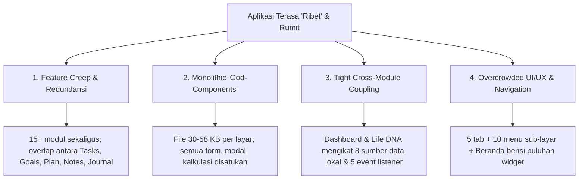

# Analisis Kompleksitas & Rencana Penyederhanaan Modul Whenya

| Atribut | Nilai |
|---|---|
| **No. Dokumen** | WHY-DOC-ARCH-2026-10-002 |
| **Versi** | 1.0 |
| **Tanggal** | 22 Oktober 2026 |
| **Topik** | Evaluasi Beban Kognitif, Redundansi Modul, & Rencana Refaktorisasi |
| **Status** | Approved for Implementation |

---

## 1. Latar Belakang & Ringkasan Masalah

Aplikasi Whenya (Personal Life Management Superapp) saat ini memiliki fitur yang sangat kaya dan matang secara fungsi dasar. Namun, baik dari sudut pandang **pengalaman pengguna (UI/UX)** maupun **kemudahan pemeliharaan kode (Developer Experience)**, seluruh modul terasa **sangat padat, rumit, dan membebani (cognitive overload)**.

Pertanyaan esensial: **"Kenapa semua module jadi terlihat ribet?"**

Berdasarkan audit mendalam terhadap seluruh modul di `mobile/` dan `web/`, ditemukan 4 akar penyebab teknis dan produk:



---

## 2. Diagnosa Mendalam Faktor Kompleksitas

### 2.1 Scope Creep & Tumpang Tindih Konsep (Feature Redundancy)
Aplikasi mencoba menjadi segala hal dalam satu waktu (*Jack of all trades*). Saat ini terdapat 15 modul independen. Sebagian besar konsep saling bertabrakan:

* **Tugas vs. Rencana vs. Tujuan:**
  * Ada `tasks.tsx` (Tugas), `plan.tsx` (Rencana), dan `goals.tsx` (Target & Milestone).
  * Pengguna bingung: *"Apakah saya harus menulis to-do di Tasks, di Plan, atau di sub-langkah Goals?"*
* **Catatan vs. Jurnal:**
  * Ada `notes.tsx` (Catatan bebas) dan `journal.tsx` (Jurnal refleksi & mood).
  * Keduanya sama-sama menyimpan tulisan personal, memecah perhatian pengguna.
* **Fitur Vertikal Terlalu Dini:**
  * Modul seperti `health.tsx` (Workouts), `reading.tsx` (Tracking buku), dan `squad/` (Social/komunitas) ditambahkan sebelum fitur pilar utama (Tugas & Keuangan) disempurnakan (masih minim virtualisasi list dan testing).

### 2.2 Monolithic 'God-Components' (Beban Kode Sumber)
Struktur kode di layar mobile tidak dipecah menjadi modul-modul kecil bertingkat, melainkan ditumpuk dalam 1 file raksasa per rute:

| File Layar | Ukuran File | Tanggung Jawab yang Dicampuradukkan |
|---|---|---|
| [goals.tsx](file:///Users/user/Projects/superapp/mobile/app/(app)/goals.tsx) | **57.9 KB** | State CRUD target, modal form, filter status/kategori, milestone journey, kalkulasi persentase, integrasi task, integrasi pomodoro, award XP gamifikasi, animasi. |
| [finance.tsx](file:///Users/user/Projects/superapp/mobile/app/(app)/finance.tsx) | **36.0 KB** | List transaksi, modal tambah uang, switch akun, sensor saldo, kalkulasi mingguan/bulanan, visualisasi bar chart, filter kategori expense/income. |
| [tasks.tsx](file:///Users/user/Projects/superapp/mobile/app/(app)/tasks.tsx) | **28.6 KB** | List task, form input, matrix prioritas, filter tag, deadline timer, koneksi ke goal, level up modal, drag/move status. |
| [pomodoro.tsx](file:///Users/user/Projects/superapp/mobile/app/(app)/pomodoro.tsx) | **26.0 KB** | Timer countdown, audio soundscapes, session logging, ambient background, task link, award XP. |
| [index.tsx](file:///Users/user/Projects/superapp/mobile/app/(app)/index.tsx) | **23.7 KB** | Dashboard agregator yang merender dan mengelola state 7 modul sekaligus. |

> **Dampak:** Setiap kali developer ingin mengubah 1 teks tombol atau warna card, mereka harus menavigasi ribuan baris kode dengan puluhan `useState` dan inline-style yang rumit.

### 2.3 Ketergantungan Silang yang Terlalu Erat (Tight Coupling)
* **Dashboard yang Terlalu Rakus Data:**
  [index.tsx](file:///Users/user/Projects/superapp/mobile/app/(app)/index.tsx) memanggil `readDashboardSources()` yang secara serentak membaca data:
  `goals`, `journal`, `transactions`, `profile`, `pomodoro`, `health`, `tasks`, dan `habits`.
  Ada 5 listener `DeviceEventEmitter` (`whenya:data-synced`, `whenya:journal-updated`, dll). Jika salah satu penyimpanan lokal gagal atau korup, layar utama akan menampilkan state error/terpukul.
* **Gamifikasi Terikat di Setiap Aksi:**
  Logika penambahan XP (`awardXP`, level up modal) disematkan secara manual di dalam hook dan komponen masing-masing (`useTasks`, `useHabits`, `pomodoro.tsx`, `index.tsx`).

### 2.4 Beban Kognitif di Antarmuka (UI/UX Clutter)
Sesuai filosofi brand di [WHENYA_MASTER_PLAN.md](file:///Users/user/Projects/superapp/docs/WHENYA_MASTER_PLAN.md), Whenya mengusung kepribadian:
> *"Modern, Calm, Intelligent, Personal — Minimalist, Soft, Premium"*

Namun antarmuka saat ini:
1. **Navigasi Terpecah:** 5 tab di bawah (`Beranda`, `Tugas`, `+ Quick Action`, `Keuangan`, `Lainnya`). Namun tab "Lainnya" menyimpan **11 destinasi menu**, ditambah halaman Beranda menyajikan baris shortcut horizontal 5 tombol lagi.
2. **Ketiadaan Fokus Utama:** Saat pengguna membuka Beranda, mereka langsung diserbu oleh ringkasan Tugas, Kebiasaan, Tujuan, Finansial, Life DNA, Notifikasi, Status Sinkronisasi, dan Pencarian sekaligus. Aplikasi terasa seperti "tuntutan pekerjaan", bukan ruang personal yang tenang (*Calm Space*).

---

## 3. Matriks Portofolio Modul (Audit Status & Rekomendasi)

Berikut klasifikasi 15 modul untuk menentukan tindakan penyederhanaan:

| No | Modul | Kategori | Nilai Produk | Kompleksitas Teknis | Rekomendasi Tindakan |
|:---:|---|---|:---:|:---:|---|
| 1 | **Tasks** (Tugas) | Core Pilar | ⭐⭐⭐⭐⭐ Tinggi | Sedang | **Pertahankan & Polishing.** Optimasi ke `FlatList`, pisahkan modal form. |
| 2 | **Habits** (Kebiasaan) | Core Pilar | ⭐⭐⭐⭐⭐ Tinggi | Sedang | **Pertahankan.** Desain sudah cukup bersih, pertahankan kesederhanaannya. |
| 3 | **Finance** (Keuangan) | Core Pilar | ⭐⭐⭐⭐⭐ Tinggi | Tinggi | **Pertahankan & Dekomposisi.** Pecah komponen transaksi dan analitik. |
| 4 | **Journal** (Jurnal) | Core Pilar | ⭐⭐⭐⭐ Tinggi | Sedang | **Pertahankan & Lebur Notes.** Jurnal menjadi satu-satunya tempat mencatat pikiran. |
| 5 | **Goals** (Target Hidup) | Pillar Pengarah | ⭐⭐⭐⭐ Tinggi | Sangat Tinggi (58KB) | **Refactor Total.** Hilangkan fitur micro-management, fokus pada visualisasi target besar. |
| 6 | **Calendar** (Kalender) | Pendukung | ⭐⭐⭐ Sedang | Sedang | **Pertahankan Ringan.** Cukup tampilkan agenda tasks dan habits. |
| 7 | **Pomodoro** (Fokus) | Pendukung | ⭐⭐⭐ Sedang | Sedang | **Pertahankan Modular.** Jadikan utility pelengkap saat mengerjakan Tugas. |
| 8 | **Plan** (Rencana) | Redundan | ⭐ Sangat Rendah | Rendah | ❌ **HAPUS / LEBUR.** Gabungkan langsung ke dalam *Goals* dan *Tasks*. |
| 9 | **Notes** (Catatan) | Redundan | ⭐ Sangat Rendah | Rendah | ❌ **HAPUS / LEBUR.** Alihkan semua kebutuhan catatan bebas ke dalam *Journal*. |
| 10 | **Health / Workout** | Niche / Scope Creep | ⭐⭐ Rendah (Fase 1) | Sedang | ⏸️ **PARKIRKAN / SEMBUNYIKAN.** Simpan untuk update mayor berikutnya (Fase 2). |
| 11 | **Reading / Buku** | Niche / Scope Creep | ⭐⭐ Rendah (Fase 1) | Sedang | ⏸️ **PARKIRKAN / SEMBUNYIKAN.** Simpan untuk update mayor berikutnya (Fase 2). |
| 12 | **Social / Squad** | Niche / Scope Creep | ⭐⭐ Rendah (Fase 1) | Tinggi | ⏸️ **PARKIRKAN / SEMBUNYIKAN.** Jangan jadikan beban di rilis awal mobile. |
| 13 | **Achievements (XP)** | Gamifikasi | ⭐⭐⭐ Sedang | Sedang | 🛡️ **DEKOPLING.** Sembunyikan pop-up yang terlalu sering; jadikan halaman pasif di profil. |
| 14 | **Life DNA / Insights** | AI / Ekosistem | ⭐⭐⭐ Sedang | Tinggi | 🛡️ **LAZY LOAD.** Jangan diproses synchronous saat boot dashboard. |
| 15 | **Finance Repository** | Sub-Keuangan | ⭐⭐ Rendah | Sedang | 🔄 **KONSOLIDASI.** Satukan langsung ke dalam tab/filter layar Keuangan. |

---

## 4. Rencana Tindakan Penyederhanaan (Simplification Blueprint)

### Fase 1: Pangkas & Satukan Modul Redundan (Segera)
1. **Eliminasi Rute `plan.tsx`:**
   * Alur perencanaan hidup cukup dikelola lewat Target/Milestone di `goals.tsx` dan rencana aksi harian di `tasks.tsx`.
2. **Eliminasi Rute `notes.tsx`:**
   * Di `journal.tsx`, sediakan filter/tab: `Refleksi Harian` dan `Catatan Bebas`.
3. **Sembunyikan Modul Niche dari Menu Utama:**
   * Lepas `Health`, `Reading`, dan `Squad` dari menu tab dan shortcut Beranda.
   * Modul-modul ini dapat tetap ada di basis kode, tetapi tidak diakses di navigasi aktif rilis MVP untuk mengurangi beban pengguna.

### Fase 2: Dekomposisi Komponen Raksasa (Refactoring)
Pecah *god-screens* menjadi komponen terisolasi dalam direktori khusus:

```text
mobile/
├── components/
│   ├── goals/
│   │   ├── GoalCard.tsx           (Komponen kartu target)
│   │   ├── GoalFormModal.tsx      (Modal tambah/edit target)
│   │   ├── GoalJourneySteps.tsx   (Daftar milestone target)
│   │   └── useGoalActions.ts      (Custom hook logika goal)
│   ├── finance/
│   │   ├── TransactionList.tsx    (List tervirtualisasi)
│   │   ├── ExpenseSummaryCard.tsx (Ringkasan saldo & grafik)
│   │   └── TransactionModal.tsx   (Form transaksi)
```

### Fase 3: Rampingkan Layar Beranda (Dashboard Decoupling)
Ubah Beranda dari "pusat kontrol yang padat" menjadi "ruang bernapas yang tenang":
* **Hanya tampilkan 3 blok utama di Beranda:**
  1. *Daily Focus:* 3 Tugas Teratas & Checklist Kebiasaan Hari Ini.
  2. *Quick Financial Snapshot:* Pengeluaran bulan ini (dengan opsi sensor).
  3. *Inspirational Reflection / AI Daily Prompt:* 1 kalimat penuntun hari ini.
* **Lazy Load Sumber Data:**
  Ganti pemanggilan masif `Promise.all` 8 modul di [index.tsx](file:///Users/user/Projects/superapp/mobile/app/(app)/index.tsx) dengan lazy loading per section agar dashboard instan terbuka dan minim beban render.

### Fase 4: Sederhanakan Struktur Navigasi
Format navigasi 4 Tab Utama yang Bersih:
* **Tab 1: Beranda** (Fokus hari ini & ringkasan esensial)
* **Tab 2: Aktivitas** (Tab terintegrasi untuk Tugas & Kebiasaan)
* **Tab 3: Keuangan** (Arus kas, rekening, dan anggaran)
* **Tab 4: Jurnal & Refleksi** (Jurnal harian, catatan, dan progres target hidup)
* *(Akses Pengaturan & Fitur Tambahan disatukan di pojok kanan atas profil).*

---

## 5. Ringkasan Kesimpulan

Modul Whenya terlihat dan terasa rumit bukan karena fiturnya buruk, melainkan karena **arsitektur produk bertumbuh terlalu lebar dalam waktu singkat tanpa dilakukan konsolidasi komponen.**

Dengan melakukan:
1. **Pengurangan modul aktif dari 15 menjadi 5 modul esensial**,
2. **Pemecahan file raksasa (58KB & 36KB) menjadi sub-komponen terisolasi**, dan
3. **Penyederhanaan layar Beranda menjadi ruang fokus harian yang tenang**,

Whenya akan kembali ke esensinya: aplikasi manajemen hidup yang **minimalis, elegan, ringan, dan menenangkan pengguna.**
