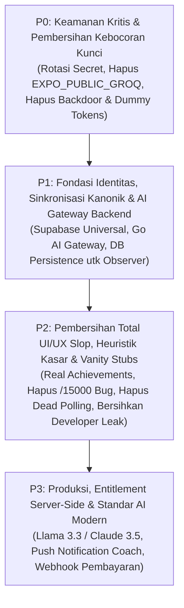

# Evaluasi Komprehensif — SuperApp (SelfOne)

> **Tanggal evaluasi:** 12 Oktober 2026
> **Cakupan:** seluruh monorepo — `backend/` (Go), `web/` (Next.js), `mobile/` (Expo), `shared/` (JS), tooling, CI/CD, dokumentasi
> **Metode:** audit statis menyeluruh semua modul + verifikasi langsung (jalankan test, typecheck, inspeksi git index, inspeksi file `.env`)
> **Tujuan dokumen:** catatan referensi lengkap bagi pengembang untuk merencanakan dan mengimplementasikan perbaikan. Setiap temuan penting dilengkapi lokasi file dan rekomendasi aksi.

---

## 1. Ringkasan Eksekutif

SuperApp (brand UI: SelfOne) adalah aplikasi personal management all-in-one (14+ modul: tasks, habits, finance, journal, health, pomodoro, reading, goals, calendar, achievements, squads, notifications) dengan arsitektur monorepo: web Next.js 16, mobile Expo SDK 57, backend Go/Fiber + PostgreSQL 16, dan package shared.

**Kesimpulan umum:** fondasi struktural sudah layak (layering backend rapi, mobile offline-first, 116 test shared yang lolos), **tapi sistem belum siap produksi**. Empat masalah sistemik terbesar:

1. **Keamanan & Kebocoran Kredensial** — backdoor pembayaran yang masih tertanam di kode (`BACKDOOR`), kredensial riil di file `.env` (termasuk API key Groq yang dibundle ke mobile binary), 1.304 file database lokal + binary terkompil yang ter-commit ke git, horizontal authorization yang rusak di backend, dan token auth mobile yang tersimpan tanpa proteksi.
2. **AI Slop, Implementasi Semu (Stubs) & Fitur Teatrikal** — fitur "AI" yang memanggil LLM berbayar tapi membuang hasilnya via `log.Printf` tanpa menyimpan ke database (`AgenticObserver`), prompt direct dari mobile membocorkan API key, polling latar belakang 30 detik dengan token dummy (`dummy-token` / token kosong) yang memicu loop 401 tak berujung, layar gamifikasi palsu dengan badge dan XP hardcoded (`achievements.tsx`), serta aturan if-else kasar yang dipoles sebagai "AI deteksi mager" atau "Local AI Engine".
3. **Konsistensi Data & Identitas** — tiga model "auth" yang tidak saling interoperabel, tiga implementasi sync aktif tanpa conflict resolution, dan duplikasi kode web/mobile yang sudah menyimpang (nilai XP, string i18n, format ID, demo currency conversion bug `/ 15000`).
4. **Monetisasi & Entitlement Rentan** — sistem premium sepenuhnya client-side dan mudah dimanipulasi, ada bug yang membuat user menjadi "premium" hanya dengan klaim hadiah harian gratis, dan paywall di mobile rusak total.

### Scorecard

| Area | Status | Catatan |
|---|---|---|
| Keamanan | [KRITIS] | Backdoor pembayaran, secret bocor, authorization rusak, direct LLM client-key |
| AI & Fitur Cerdas | [KRITIS / SLOP] | Observer hantu (`log.Printf` buang output), dead polling 30s, token dummy, fake achievements, direct client key |
| Data & Sync | [KRITIS] | 3 implementasi sync, last-write-wins, tanpa conflict resolution, mobile unencrypted |
| Identitas & Auth | [TINGGI] | 2 model yang tidak interoperabel; token web (SA-…) tidak valid di backend |
| Backend | [SEDANG] | Layering bagus; gap: authorization, test, goroutine leaks, AI stubs & model lama |
| Web | [SEDANG] | Fitur lengkap; 0 test, dead code polling hantu, masalah re-render global |
| Mobile | [TINGGI] | Upgraded SDK 57; premium rusak, 0 test, token tidak aman, fake UI achievements |
| Shared | [BAIK] | 116 test lolos; tapi ±6 modul memiliki duplikat yang sudah menyimpang |
| CI/CD | [KRITIS] | Dormant: semua path filter menunjuk `packages/` yang tidak ada |
| Testing | [TINGGI] | Hanya shared (116) + auth middleware backend (6); web & mobile nol |
| Dokumentasi | [SEDANG] | Stale: versi salah, path salah, tidak selaras dengan kode |
| Git hygiene | [KRITIS] | 1.304 file DB + binary Go + Firebase config ter-track |

### 10 Masalah Teratas (harus dikerjakan pertama — detail di §4.1, §4.10, & §5)

| # | Masalah | Lokasi |
|---|---|---|
| 1 | Backdoor pembayaran: nama profil mengandung `BACKDOOR` → token premium gratis; route-nya juga tanpa auth | `web/app/api/checkout/route.js:35-43`, dihormati oleh `web/app/premium/page.js:81-90` |
| 2 | Kredensial riil di file `.env` di disk + **`EXPO_PUBLIC_GROQ_API_KEY` ter-bundle ke aplikasi mobile** (user bisa extract API key dari binary) | `backend/.env`, `mobile/.env`, `web/.env.local`, `.env.local` (root), `mobile/lib/ai.ts:5` |
| 3 | **AI Slop Arsitektural:** `AgenticObserver` memanggil Groq/Claude lalu membuang respons via `log.Printf` tanpa simpan ke DB; `CorrelationEngine` & `ParseHandler` rawan prompt injection & string slicing rapuh | `backend/internal/usecase/agentic_observer.go:120-122`, `parse_handler.go:45-50` |
| 4 | **Polling Hantu & Token Dummy:** Polling 30s membaca `localStorage.getItem('token')` (selalu null) di web; fallback string `'dummy-token'` di mobile | `web/components/AICoachPopup.js:15`, `CrossModuleInsights.js:17`, `mobile/components/QuickCaptureModal.tsx:36`, `useAICoach.ts:10` |
| 5 | **UI Vanity Slop & Mock Badges:** Layar achievements mobile sepenuhnya palsu (array static 6 badge, text 850 XP statis); konversi mata uang demo `amount / 15000` di mobile helpers | `mobile/app/(app)/achievements.tsx:12-19, 47-53`, `mobile/lib/helpers.ts:27` |
| 6 | `JWT_SECRET=OKEBOS123` (9 karakter) → forging token HS256 trivial jika fallback HMAC aktif | `backend/.env:9` |
| 7 | 1.304 file data PostgreSQL + binary `backend/main` ter-track di git (di-ignore hanya setelah committed) | `backend/data/postgres/**`, `backend/main` |
| 8 | Tidak ada webhook pembayaran + tidak ada auth di route checkout → status pembayaran sepenuhnya client-trustable | `web/app/api/checkout/route.js` (tidak ada `/api/webhook`) |
| 9 | Horizontal authorization rusak: user mana pun bisa tandai-read coach message user lain; endpoint squad/challenge tanpa cek membership; stub challenge progress (`Current = increment`) | `backend/internal/repository/coach_repository.go:29-35`, `backend/internal/delivery/http/social_handler.go:68-138`, `social_usecase.go:76-83` |
| 10 | Payload sync mobile TIDAK dienkripsi; UI "Enkripsi E2E" di profil hanya kosmetik; fallback crypto `'superapp_fallback_key_not_for_production'` | `mobile/lib/syncService.ts:33-37`, `mobile/app/(app)/profile.tsx:216-235`, `mobile/lib/secureStorage.ts:40-51` |

### Kekuatan yang harus dipertahankan

- **Layering backend bersih**: handler → usecase → repository, ports di domain, manual DI di `cmd/api/main.go`.
- **Auth backend fail-closed**: menolak start jika `JWT_SECRET` maupun `SUPABASE_JWKS_URL` tidak diset (`cmd/api/main.go:126-128`); verifikasi JWKS dengan cache per-`kid` + refresh saat rotasi key; 6 test unit mengcovernya (`internal/middleware/auth_test.go`) — satu-satunya paket backend yang di-test.
- **Endpoint `/storage/migrations` adalah kode terbaik di backend**: idempotency ledger, transaksional, revision guard (stale write ditolak), checksum SHA-256, limit ukuran — dan satu-satunya handler dengan error handling yang benar (pesan generik, tanpa bocor internal).
- **116 test shared yang lolos** (diverifikasi 12 Okt 2026) — satu-satunya coverage test yang bermakna di monorepo.
- **Mobile fully offline-first & upgraded to Expo SDK 57**: seluruh aplikasi berfungsi tanpa jaringan dan kompatibel dengan Expo Go runtime modern.
- **Monorepo tooling berfungsi** — pnpm workspaces + Turborepo berjalan mulus (diverifikasi: test & typecheck).

---

## 2. Gambaran Sistem

### 2.1 Stack & Versi Aktual

| Komponen | Teknologi | Versi (terverifikasi di file) |
|---|---|---|
| Web | Next.js (App Router, JavaScript) + React | **next 16.1.6, react 19.1.0** (`web/package.json:20-21`) — README masih menulis "Next.js 14" |
| Mobile | Expo / React Native + Expo Router (TypeScript, `strict: false`) | **SDK 57, RN 0.86.3, react 19.2.3** (`mobile/package.json:39`, diupgrade dari SDK 54 untuk kesesuaian Expo Go) |
| Backend | Go + GoFiber v2 + GORM | Go 1.22, fiber v2.52.13, gorm v1.31.1 (`backend/go.mod`) |
| Database | PostgreSQL 16 (docker-compose, port host 5433) + pgAdmin | `docker-compose.yml` |
| Identitas (mobile & web-cloud) | Supabase Auth | supabase-js **2.38 (mobile) vs 2.97 (web)** — drift besar di library security-sensitive |
| Pembayaran | Midtrans Snap | **sandbox hardcode**, `isProduction: false` di route |
| AI | Groq (backend: `llama-3.1-8b-instant` [deprecated], mobile: `llama-3.3-70b-versatile` direct client call) + Claude (opsional, `claude-3-sonnet-20240229`) | `backend/internal/usecase/ai_service.go:27,52,80`, `mobile/lib/ai.ts:5` |
| Monorepo | pnpm 9 + Turborepo 2 | `package.json`, `pnpm-workspace.yaml` |

### 2.2 Arsitektur & Alur Data Saat Ini

```
 WEB (Next.js 16)                     MOBILE (Expo 54)
 ┌────────────────────────┐            ┌────────────────────────┐
 │ Profil lokal tanpa pw  │            │ Supabase email/password│
 │ session "SA-XXXXXXXX"  │            │ JWT Supabase           │
 │ (token self-issued)    │            │                        │
 └──────────┬─────────────┘            └──────────┬─────────────┘
            │ localStorage mirror + localforage   │ AsyncStorage
            │ (IndexedDB)                         │ (+EncryptedStorage utk
            ▼                                      ▼  finance/journal saja)
   ┌─────────────────┐  sync (3 implementasi, tidak ada conflict resolution)
   │ 1. web/lib/     │ → Supabase table user_sync_data (AES, LWW, version=1)
   │    cloudSync.js │
   │ 2. mobile/      │ → Go POST /context/sync (PLAINTEXT, Bearer JWT)
   │    syncService  │
   │ 3. web/lib/     │ → Go POST /storage/migrations (one-way, plaintext,
   │    database-    │    checksum, idempoten)  ← satu-satunya yang solid
   │    migration.js │
   └────────┬─────────┘
            ▼
   BACKEND (Go/Fiber) ── JWT via JWKS Supabase (atau HMAC legacy)
   ┌─────────────────────────────────────────────┐
   │ /api/v1: context, users, storage, social,   │
   │ insights, coach, parse                      │
   │ PostgreSQL 16 (GORM AutoMigrate, tanpa index│
   │ di model, 3 mekanisme skema yang bertabrakan│
   └──────────────┬──────────────────────────────┘
                  ▼
   AI: Groq/Claude (kunci di server) — observer hanya LOG hasil, tidak persist
   AI mobile: Groq LANGSUNG dari device dengan kunci di bundle (EXPO_PUBLIC)
```

### 2.3 Temuan Inti: Tiga Model Identitas yang Tidak Saling Interoperabel

| Platform | Model auth | Token |
|---|---|---|
| Web (intinya) | Profil lokal: nama + avatar, **tanpa password** | `SA-XXXXXXXX-<base36 ts>` — dibuat sendiri client (`shared/lib/auth.js:83,107`) |
| Web (opsional) | Link akun Supabase (`CloudAccountCard`) | JWT Supabase |
| Mobile | Supabase email/password penuh | JWT Supabase (`superapp_session_token`) |
| Backend | Hanya menerima **JWT valid** (JWKS Supabase / HMAC legacy) | — |

**Konsekuensi konkret: `sessionToken` web (SA-…) bukan JWT**, sehingga panggilan web ke backend yang memakainya — halaman squads (`web/app/squads/page.js:20-22`) dan QuickCapture (`web/components/QuickCapture.js:49-57`) — **ditolak 401 oleh backend**. Hanya panggilan web yang memakai JWT Supabase (database migration, `users/sync` setelah link akun) yang benar-benar bekerja. Di sisi lain, mobile mengirim JWT Supabase yang valid. Artinya **model identitas web↔backend rusak dan harus diunifikasi** (§5-P1).

---

## 3. Analisis Per Modul

### 3.1 Backend (Go)

**Arsitektur:** layering rapi (domain ports → repository GORM → usecase → handler), route mendaftarkan diri sendiri di `New*Handler(...)`, semua route (kecuali `GET /health`) berada di bawah `JWTMiddleware` + `ProvisionUser` (`cmd/api/api/main.go:131-134` — sebenarnya `cmd/api/main.go:131-134`). Pool DB: max 25 open / 5 idle / lifetime 30 menit (env-overridable).

**API surface:** `POST /context/sync` (202 + goroutine), `POST /users/sync`, social (leaderboard, squads CRUD, challenges, progress), insights (GET + generate), coach (messages, read, generate), `POST /parse` (NLP Groq), storage (`POST /storage/migrations`, `GET /storage`).

**Temuan:**

| Level | Temuan | Lokasi | Dampak / Aksi |
|---|---|---|---|
| [KRITIS] | `POST /coach/messages/read` **tanpa cek ownership** — user mana pun bisa tandai-read message user lain | `internal/repository/coach_repository.go:29-35` | Tambah filter `user_id = $sub` |
| [KRITIS] | Endpoint squad/challenge tanpa validasi membership/ownership (list challenge squad mana pun, buat challenge di squad mana pun, post progress di challenge mana pun) | `internal/delivery/http/social_handler.go:68-138`, `internal/usecase/social_usecase.go:48-89` | Tabel `squad_members` + cek membership di semua endpoint |
| [KRITIS] | **3 mekanisme skema yang bertabrakan**: (a) GORM AutoMigrate saat startup — yang benar-benar dipakai; (b) `sql/init.sql` (hanya jalan saat first-init volume kosong) membuat `users.password_hash TEXT NOT NULL` yang tidak pernah diisi app → **setiap request 500 di DB hasil Docker init**; (c) `migrations/*.sql` — **tidak diterapkan oleh kode apa pun** (tidak ada golang-migrate di go.mod) | `cmd/api/main.go:63-83`, `backend/sql/init.sql:17`, `backend/migrations/` | Satukan ke satu runner (golang-migrate); hapus init.sql & migrations yatim; AutoMigrate failure harus fatal |
| [TINGGI] | Goroutine tak terbatas per request `/context/sync` + kirim ke channel (buffer 100) tanpa timeout; consumer single-loop memanggil AI berdetik-detik → goroutine bisa block tak berhingga | `internal/usecase/context_usecase.go:30-40`, `internal/usecase/agentic_observer.go:21,34` | Queue bounded + backpressure (atau minimal context timeout) |
| [TINGGI] | `AIService` membuat `http.Client{}` per request **tanpa timeout** → goroutine bisa hang selamanya saat API AI macet; hasil `http.NewRequest` di-discard | `internal/usecase/ai_service.go:102,111` | Shared client + timeout (mis. 30s) |
| [TINGGI] | **Tidak ada rate limiting** di endpoint berbiaya (`/parse`, `/coach/generate`, `/insights/generate`, `/context/sync` → memicu panggilan Groq/Claude) → cost abuse oleh user terautentikasi mana pun | seluruh route `/api/v1` | `fiber middleware.Limit` per route + global |
| [TINGGI] | Error internal dibocorkan ke client di sebagian besar handler (`err.Error()` di respons 500) | `user_handler.go:60`, `social_handler.go:31,42,62,93,111,134`, `insight_handler.go:31,42`, `coach_handler.go:32,49,60`, `parse_handler.go:50,65` | Ikuti pola `storage_handler.go:77,89` (pesan generik) |
| [SEDANG] | `GetByUserID` di `user_context` **tanpa LIMIT** (muat seluruh riwayat user) padahal consumer hanya mengambil 51 baris pertama; model GORM **tanpa index** (`user_context.user_id` — query terpanas — `squads.creator_id`, `challenges.squad_id`, `leaderboard_entries.total_xp`) | `internal/repository/context_repository.go:22-26`, `coach_engine.go:41-44`, `correlation_engine.go:42-45` | Tambah LIMIT + index di model / migration |
| [SEDANG] | Kegagalan AutoMigrate di-treat sebagai **non-fatal** dan error DDL extension di-ignore → API bisa start dengan skema rusak | `cmd/api/main.go:63,81` | Gagal fatal saat startup |
| [SEDANG] | `UpdateProgress` menset `Current = increment` (bukan akumulasi) dan tidak pernah menandai challenge selesai — stub yang diakui di komentar | `internal/usecase/social_usecase.go:75-83` | Implementasi akumulasi + completion |
| [SEDANG] | `AgenticObserver` memanggil AI (berbayar) untuk setiap event FINANCE/HEALTH lalu **hanya log hasilnya** — tidak persist, tidak dipakai | `internal/usecase/agentic_observer.go:115-122` | Persist ke tabel insights atau nonaktifkan sementara |
| [SEDANG] | `/users/sync` menerima email dari client dan bisa **menimpa** email riil user (hanya `sub` yang di-trust) | `internal/delivery/http/user_handler.go:44-47` | Ambil email dari claim JWT saja |
| [RENDAH] | Logging ad-hoc (`log.Printf` + tag), tanpa structured log / request ID; error wrapping tidak konsisten; komentar campur ID/EN; duplikasi blok strip-markdown 3×; "get uuid from Locals" diulang di tiap handler | `agentic_observer.go`, `parse_handler.go:53-61`, dll. | `slog` + helper `uuidFromContext(c)` |
| [RENDAH] | Model AI dipin ke versi deprecated (`llama-3.1-8b-instant`, `claude-3-5-sonnet-20240229`) | `ai_service.go:27,52,80` | Update model ID, jadikan configurable |
| [RENDAH] | JWKS tanpa singleflight — refresh storm saat cache cold/expired | `internal/middleware/jwks.go:86-118` | `golang.org/x/sync/singleflight` (sudah di go.sum) |
| [INFO] | Dependensi minim & modern (fiber v2.52, jwt v5.3, gorm 1.31); cukup `go get -u` berkala. SQL injection risk rendah (semua input via placeholder GORM) | `backend/go.mod` | — |

### 3.2 Web (Next.js 16)

**Arsitektur:** 16 route, **semua client component** (kecuali root layout & route checkout); `AppShell` menumpuk provider (Language > User > Premium > Pomodoro > AuthGuard > Sidebar + OnboardingModal + QuickCapture + AICoachPopup); satu `ErrorBoundary` kelas di root; `globals.css` 3.140 baris (seluruh design system dalam satu file global); PWA manifest + service worker **tanpa strategi fetch/offline cache**.

**Temuan:**

| Level | Temuan | Lokasi | Dampak / Aksi |
|---|---|---|---|
| [KRITIS] | **Backdoor pembayaran**: `userName.includes('BACKDOOR')` → respons `isBackdoor: true` + dummy token; client memanggil `buyPackage` langsung → **token premium gratis** | `web/app/api/checkout/route.js:35-43`, `web/app/premium/page.js:81-90` | Hapus total; tidak boleh ada bypass di kode produksi |
| [KRITIS] | **Tidak ada webhook Midtrans** — "sukses bayar" = callback client `snap.onSuccess` yang langsung mint token ke localStorage; route POST juga **tanpa auth** (anonim bisa mint Snap token); `isProduction: false` hardcode (env `NEXT_PUBLIC_MIDTRANS_PRODUCTION=true` diabaikan); Snap selalu dimuat dari URL sandbox | `web/app/api/checkout/route.js:9,14-24`, `web/app/premium/page.js:39-54,93-109` | Webhook + verifikasi server-side; hormati flag production; auth di route |
| [TINGGI] | **Bug ekonomi harian**: `claimDailyToken()` meng-increment `totalPurchased` → `isPremiumUser()` (`totalPurchased > 0`) jadi true → **klaim hadiah harian gratis sekali = "premium" permanen** (test bahkan meng-assert ini sebagai perilaku ekspektasian) | `shared/lib/tokenSystem.js:166-190,219-222`, `shared/__tests__/tokenSystem.test.js` | Pisahkan `totalPurchased` dari `totalClaimed`; premium ditentukan server (lihat §5-P3) |
| [TINGGI] | Token Bearer mati/kosong: `AICoachPopup.js:15` & `CrossModuleInsights.js:17` membaca `localStorage.getItem('token')` — key yang **tidak pernah ditulis oleh kode mana pun** → polling 30 detik mengirim Bearer kosong (dan kedua komponen adalah dead code — tidak di-import) | `web/components/AICoachPopup.js`, `web/components/CrossModuleInsights.js` | Hapus atau arahkan ke session Supabase sungguhan |
| [TINGGI] | **5 modul terduplikasi dengan shared**, 2 di antaranya sudah menyimpang: `dictionaries.js` (web 1.159 baris *menimpa* shared 1.410 baris), `cloudSync.js` (versi web-Supabase aktif vs versi shared-Go mati), `notifications.js` & `roast.js` (salinan verbatim), `pomodoroContext.js` (varian lokal) | `web/lib/*` vs `shared/lib/*`, diwiri `web/components/AppShell.js:13,49` | Satu sumber per modul di shared; web re-export |
| [TINGGI] | `PomodoroProvider` membuat context value **tanpa memoization** → tick per detik re-render seluruh pohon aplikasi (Sidebar + halaman aktif) selama timer berjalan | `web/lib/pomodoroContext.js:309-316` | `useMemo` / pecah context (state vs timer) |
| [SEDANG] | Tidak ada `loading.js`/`error.js`/`not-found.js` di mana pun; `ErrorBoundary` menawarkan `localStorage.clear()` yang **menghapus semua profil** (destruktif) dan me-render string error mentah (info disclosure) | `web/components/ErrorBoundary.js:23,49-52` | Route-level loading/error; reset hanya untuk state error |
| [SEDANG] | 14 halaman fitur nyaris identik: pagination manual di-copy-paste ~15×, blok loading spinner dengan teks Indonesia hardcode (tidak pakai i18n padahal dictionary ada), scan O(n) localStorage di tiap mount | semua `web/app/*/page.js` | Ekstrak `PageShell` + `usePaginatedData` + komponen loading ter-i18n |
| [SEDANG] | Dead code: komponen `CrossModuleInsights` (107 baris), `ProInsights` (260 baris), `DailyPopup`, `XPBar`, `ThemeToggle` (0 byte), `themeContext.js` (0 byte), `page.module.css` (sisa scaffold), `getDataSync` (tanpa caller), event `storage_update`/`open-quick-capture` (tanpa listener/dispatcher) | `web/components/*`, `web/lib/*` | Hapus |
| [SEDANG] | **Tidak ada security headers sama sekali** — `next.config.mjs` tidak mendefinisikan `headers()` (tanpa CSP, HSTS, X-Frame-Options, Referrer-Policy) | `web/next.config.mjs` | Tambah `headers()` |
| [SEDANG] | `NEXT_PUBLIC_ENCRYPTION_KEY` di `.env.example` **tidak dibaca kode mana pun** (kunci aktual = `SYNC_PASSWORD` user) — surface config yang menyesatkan | `web/.env.example:11` | Hapus atau implementasikan |
| [RENDAH] | Style inline masif di samping utility class yang sudah ada; komponen didefinisikan di dalam render (`PieChart`, `WeightChart`, `StarRating`, `TaskCard`); pagination tidak reset saat filter berubah; `document.title` & favicon di-set dari Sidebar | `web/app/*/page.js`, `web/components/Sidebar.js:74-92` | Refactor per halaman saat disentuh |
| [RENDAH] | Branding drift: package/manifest "SuperApp" vs UI "SelfOne" | `web/app/layout.js:6` | Keputusan branding (§5-P3) |
| [INFO] | **Tidak ditemukan vektor XSS**: zero `dangerouslySetInnerHTML`, tidak ada markdown renderer, konten jurnal di-render sebagai plain text (`whiteSpace: pre-wrap`) | grep terverifikasi | — |
| [INFO] | **0 test** di web; tidak ada test framework. Typecheck (`tsc --noEmit`, `checkJs`) lolos | `web/` | Tambah Vitest untuk logika inti (premium, storage) |

### 3.3 Mobile (Expo SDK 54)

**Arsitektur:** Expo Router — 5 tab terlihat (Today, Plan, Capture, Notes, Me) + 13 layar hidden; offline-first penuh (AsyncStorage); provider tree di `app/_layout.tsx`; `scripts/preflight.mjs` (221 baris) sebagai gate dev/build yang bagus.

**Temuan:**

| Level | Temuan | Lokasi | Dampak / Aksi |
|---|---|---|---|
| [KRITIS] | **Session auth di plain AsyncStorage**: `superapp_session` menyimpan JSON lengkap termasuk **refresh token**; `expo-secure-store` sudah dependency & dipakai (untuk PIN) tapi tidak untuk auth | `mobile/hooks/useAuth.tsx:91-102,154,351` | Pindahkan ke SecureStore/Keychain |
| [KRITIS] | **Kunci Groq API di-bundle ke aplikasi** (`EXPO_PUBLIC_GROQ_API_KEY` terkompil ke client; key riil ada di `mobile/.env`) — bisa diekstrak & disalahgunakan; data user (task/journal/habit) dikirim langsung dari device ke Groq | `mobile/lib/ai.ts:5`, `mobile/.env:1` | Proksikan AI lewat endpoint backend (kunci di server) |
| [KRITIS] | Backend via **HTTP cleartext** dan URL LAN riil di `.env` (`http://10.254.29.39:8080/api/v1`) → JWT + data user terbaca di jaringan | `mobile/.env`, `mobile/lib/config.ts:14` | TLS wajib; jangan hardcode IP LAN |
| [KRITIS] | **Payload sync mobile tidak dienkripsi** (raw JSON ke `/context/sync`), push-only, tanpa queue offline, tanpa retry, full-snapshot LWW; UI "Enkripsi E2E Cloud Sync" di profil **kosmetik** — `SYNC_PASSWORD` disimpan di plain AsyncStorage dan tidak pernah dipakai path sync | `mobile/lib/syncService.ts:33-37,47-101`, `mobile/app/(app)/profile.tsx:47-53,216-235` | Terapkan enkripsi (§5-P1) + queue offline |
| [TINGGI] | **Premium di mobile tidak berfungsi sama sekali**: `premiumContext.tsx:34` membaca key `superapp_user_id` yang **tidak pernah ditulis oleh kode mana pun** → lookup selalu null → `isPremium` selalu false; `usePremium()` tidak dipanggil layar mana pun; badge "PREMIUM" di profil **hardcode untuk semua orang**; tidak ada jalur checkout apa pun | `mobile/context/premiumContext.tsx:32-55`, `mobile/app/(app)/profile.tsx:131-134` | Entitlement server-side (§5-P3) |
| [TINGGI] | Bug XP: `addXP('GOAL_ACHIEVED')` bukan action yang valid (peta punya `GOAL_COMPLETE`) → 0 XP diberikan dalam diam | `mobile/app/(app)/goals.tsx:119` vs `mobile/lib/gamification.ts:27-38` | Samakan nama action (lihat §5-P1) |
| [TINGGI] | Layar achievements **palsu**: array badge hardcode dengan `unlocked: true/false` konstan + statistik "850 XP" hardcode — sementara web punya sistem achievements riil | `mobile/app/(app)/achievements.tsx:12-19,47-53` | Implementasikan dari data gamification riil |
| [TINGGI] | Fallback `EncryptedStorage` berbahaya: master key dari `Math.random()` saat expo-crypto gagal, dan **key hardcode** `'superapp_fallback_key_not_for_production'` yang dipakai mengenkripsi data riil; plus monkey-patch global `CryptoJS.lib.WordArray.random` | `mobile/lib/secureStorage.ts:11-24,40-51` | Gagal keras (fail-fast) alih-alih fallback lemah |
| [TINGGI] | **EAS submit tidak runnable**: `serviceAccountKeyPath: ./google-service-account.json` tidak ada di disk, ID Apple placeholder (`your@apple.com`, `YOUR_APP_STORE_CONNECT_APP_ID`), tidak ada EAS secrets, tidak ada env per profile di `eas.json` | `mobile/eas.json:32-44` | Lengkapi sebelum rilis store |
| [SEDANG] | **Gap parity vs web**: tidak ada UI reminders (key `REMINDERS`/`NOTIFICATION_HISTORY` didefinisikan tapi tidak pernah dipakai), tidak ada premium, settings parsial, tidak ada privacy/terms; (mobile punya yang tidak ada di web: onboarding, PIN lock, daily quest, social challenges, Life-DNA radar) | tabel di §4.8 | Roadmap parity |
| [SEDANG] | Duplikat menyimpang dari shared: `gamification.ts` ("port from web") dengan **nilai XP & nama action berbeda** (JOURNAL_ENTRY 20 vs JOURNAL_WRITE 10, POMODORO_SESSION 25 vs POMODORO_DONE 20, BOOK_COMPLETE 75 vs BOOK_FINISH 30); `helpers.ts` memakai `generateId` lemah (`Date.now()+Math.random`) dan konversi "USD" palsu `amount / 15000` "for demo" | `mobile/lib/gamification.ts:27-38`, `mobile/lib/helpers.ts:27` | Satu sumber di shared |
| [SEDANG] | i18n: key `gamification.level1..level10` tidak ada di dictionary → `t()` merender key mentah; delay buatan 800 ms saat ganti bahasa; onboarding hardcode bahasa Indonesia; salah key placeholder email login | `mobile/components/LevelUpModal.tsx:66`, `mobile/context/languageContext.tsx:56`, `mobile/app/onboarding.tsx`, `mobile/app/(auth)/login.tsx:92` | Perbaiki key + hapus delay buatan |
| [SEDANG] | `ai.ts` membandingkan tanggal habit dengan `toLocaleDateString()` padahal habit menyimpan `YYYY-MM-DD` → feed pola 7 hari hampir tidak pernah match | `mobile/lib/ai.ts:34-49` vs `mobile/hooks/useHabits.ts:69-90` | Normalisasi format |
| [SEDANG] | Dependensi drift: `@supabase/supabase-js 2.38` (web 2.97 — library auth yang security-sensitive tertinggal jauh), `expo-network ^55` (drift dari modul SDK 54 lainnya), `expo-av` + `expo-audio` dobel (audio yang dipakai hanya expo-av), `@types/react-native ^0.72` deprecated | `mobile/package.json` | Upgrade + hapus duplikat |
| [SEDANG] | **0 test** (script `test: jest` ada tapi tidak ada konfigurasi & file test — script mati); TS `strict: false`, `any` tersebar, `index.tsx` 762 baris (data + gamification + 4 modal + layout dalam satu file) | `mobile/` | Jest config + test smoke; pecah index.tsx |
| [SEDANG] | Panggilan `POST /users/sync` saat register **tanpa Authorization header**; fallback `dummy-token` sebagai Bearer di 3 komponen | `mobile/hooks/useAuth.tsx:308-312`, `QuickCaptureModal.tsx:36`, `CrossModuleInsights.tsx:23,43`, `useAICoach.ts:10` | Hapus fallback; auth sebelum sync |
| [RENDAH] | App PIN 4 digit disimpan **tanpa hash** di SecureStore; `google-services.json` (API key Firebase) ter-track di git padahal tidak ada dependency/firebase import apa pun; `UIBackgroundModes` terduplikasi 2× di app.json; README mobile stale | `mobile/context/securityContext.tsx:5,101-109`, `mobile/google-services.json`, `mobile/app.json:25-30` | Hash PIN; hapus google-services.json; rapikan app.json |

### 3.4 Shared (`@superapp/shared`)

- **Plain JavaScript ESM** (bukan TypeScript), meski ada `tsconfig.json` dengan `checkJs` (lolos). `package.json` mendeklarasikan `"types": "index.d.ts"` **yang tidak ada** — deklarasi rusak.
- **116 test lolos** (4 suite: helpers, gamification, tokenSystem, storage) — diverifikasi 12 Okt 2026. Ini satu-satunya coverage bermakna di monorepo.
- **Duplikat aktif yang sudah menyimpang** (risiko drift sudah nyata, bukan hipotetis):

| Modul | Salinan | Status |
|---|---|---|
| `storage` | `shared/lib/storage.js` + `web/lib/storage.js` (localforage) + `mobile/lib/storage.ts` (AsyncStorage) | 3 salinan, `STORAGE_KEYS` terduplikasi dengan nama member berbeda |
| `cloudSync` | `shared/lib/cloudSync.js` (Go `/sync` — **mati**: route tidak ada, tanpa auth header) + `web/lib/cloudSync.js` (Supabase — aktif) | 2 implementasi berbeda |
| `gamification` | `shared/lib/gamification.js` + `mobile/lib/gamification.ts` | Nilai XP & nama action berbeda |
| `dictionaries` | `shared/lib/dictionaries.js` (1.410 baris) + `web/lib/dictionaries.js` (1.159 baris) | String sudah berbeda (mis. judul login) |
| `helpers` | `shared/lib/helpers.js` + `mobile/lib/helpers.ts` | Versi mobile lebih lemah (generateId, currency) |
| `notifications`, `roast`, `pomodoroContext` | shared + web | Salinan / varian lokal |

- Modul yang **membaca `window.localStorage` langsung** (`gamification`, `tokenSystem`, `backup`) pada dasarnya web-only — tidak berfungsi di React Native, padahal di-deklarasikan sebagai shared.
- **`encryption.js`**: `CryptoJS.AES.encrypt(data, passphrase)` = mode passphrase dengan KDF `EVP_BytesToKey` (MD5, tanpa iterasi) → **brute-force offline cepat** untuk passphrase lemah; tanpa AEAD (tidak ada integritas). Kunci = `SYNC_PASSWORD` yang disimpan **plaintext** di localStorage/AsyncStorage. Perlindungan yang ada hanya terhadap server, bukan terhadap akses perangkat/browser.
- **`backup.js`**: export **plaintext** tanpa enkripsi; `importData` menulis key ke localStorage **tanpa re-namespacing** → import backup milik user lain menimpa/merger data secara global.
- **`cloudSync.js`** (shared) masih di-`import()` dinamis oleh `shared/lib/storage.js:95` di setiap `setData` — padahal modulnya mati (route `/sync` tidak ada di backend, dan tanpa auth header).
- i18n: 2 bahasa (id/en), ~26 section, dot-path lookup dengan fallback; provider di shared, tapi mobile punya provider sendiri (deteksi locale) dan web menimpa dictionary-nya dengan salinan lokal.

### 3.5 Monorepo, CI/CD, Script, Git Hygiene

- **Tooling berfungsi**: pnpm workspaces (4 package) + Turborepo; `pnpm install`/`test`/`typecheck` berjalan (diverifikasi).
- **CI/CD secara efektif dormant (KRITIS)**: semua path filter di ketiga workflow menunjuk `packages/web|mobile|shared/**` — **direktori `packages/` tidak ada** (repo memakai `web/`, `mobile/`, `shared/`), sehingga GitHub melewatkan semua workflow pada push/PR. Job EAS juga memakai `working-directory: packages/mobile` (pasti gagal). Kalaupun jalan: tidak ada gate test (116 test shared tidak pernah dieksekusi di CI), tidak ada lint/typecheck mobile, **tidak ada CI backend sama sekali** (Go build/test/vet), tidak ada security scanning (`pnpm audit`, `govulncheck`, CodeQL, secret scanning), tidak ada deploy web.
  - File: `.github/workflows/web-ci.yml`, `mobile-ci.yml`, `mobile-release.yml`
- **Script starter rusak**: `START_APP.sh` dan `START_MOBILE.sh` hardcode path salah (`/Users/user/superapp` — repo di `/Users/user/Projects/superapp`); `START_MOBILE.sh` menjalankan `npm install --legacy-peer-deps` (package manager salah untuk workspace pnpm).
- **docker-compose tidak bisa jalan langsung**: mensyaratkan root `.env` (`POSTGRES_PASSWORD:?` wajib) yang **tidak ada di disk**; volume mount menunjuk ke `./backend/data/postgres` — direktori yang justru ter-track di git.
- **Git hygiene (diverifikasi via `git ls-files`):**
  | Artefak | Status |
  |---|---|
  | `backend/data/postgres/**` — 1.304 file data PostgreSQL 16 riil (base/, pg_wal/, pg_hba.conf) | **TER-TRACK** (rule .gitignore ditambahkan setelah file committed) |
  | `backend/main` — binary Mach-O arm64 (output `go build -o main`) | **TER-TRACK** |
  | `backend/api` — binary Mach-O arm64 | untracked (tapi tidak ada rule .gitignore yang mencegahnya) |
  | `mobile/google-services.json` (API key Firebase, tak terpakai) | **TER-TRACK** (hanya `google-service-account.json` yang di-ignore) |
  | `backend/run_log.txt` (log kosong) | **TER-TRACK** |
  | Semua `.env*` berisi secret | untracked & di-ignore dengan benar (diverifikasi) — **tapi mengandung kredensial produksi riil di disk** |
  | `.dockerignore` | **tidak ada** → `COPY . .` di Dockerfile membakar `.env` + data DB + binary |
- Jika repo pernah di-push ke remote (README menyebut repo GitHub publik), **data database lokal, binary, dan Firebase config terekspos** — dan seluruh kredensial di `.env` harus dianggap bocor.

---

## 4. Analisis Cross-Cutting

### 4.1 Keamanan (konsolidasi semua modul, berurutan dari paling parah)

| # | Level | Temuan | Lokasi |
|---|---|---|---|
| S1 | KRITIS | Backdoor pembayaran (nama `BACKDOOR` → token gratis) + dihormati client | `web/app/api/checkout/route.js:35-43`, `web/app/premium/page.js:81-90` |
| S2 | KRITIS | Kredensial riil di disk: password pooler Supabase DB, `JWT_SECRET`, 2× Groq (satu di `EXPO_PUBLIC_` → ikut ter-bundle), Anthropic, server key Midtrans, webhook Apps Script publik | `backend/.env`, `mobile/.env`, `web/.env.local`, `.env.local` |
| S3 | KRITIS | `JWT_SECRET=OKEBOS123` — fallback HMAC aktif → forging token untuk seluruh API | `backend/.env:9`, `backend/internal/middleware/auth.go:47-58` |
| S4 | KRITIS | 1.304 file data DB + binary ter-track di git (potensi ekspos data user lokal) | `backend/data/postgres/**`, `backend/main` |
| S5 | KRITIS | Pembayaran tanpa webhook + route tanpa auth → minting token sepenuhnya client-trustable | `web/app/api/checkout/route.js` |
| S6 | KRITIS | Horizontal authorization: `coach/messages/read` tanpa filter owner; squad/challenge tanpa membership | `coach_repository.go:29-35`, `social_handler.go:68-138` |
| S7 | KRITIS | Mobile: refresh token di plain AsyncStorage; kunci Groq di bundle; backend HTTP cleartext | `useAuth.tsx:91-102`, `lib/ai.ts:5`, `mobile/.env` |
| S8 | KRITIS | Tanpa `.dockerignore` → image membakar secret + data + binary | `backend/Dockerfile:8` |
| S9 | TINGGI | Sync mobile plaintext; UI "E2E" kosmetik | `mobile/lib/syncService.ts:33-37` |
| S10 | TINGGI | KDF lemah (EVP/MD5, tanpa iterasi) + tanpa AEAD; `SYNC_PASSWORD` plaintext | `shared/lib/encryption.js`, `web/lib/cloudSync.js:83` |
| S11 | TINGGI | Fallback enkripsi berbahaya (Math.random + key hardcode) | `mobile/lib/secureStorage.ts:40-51` |
| S12 | TINGGI | Tanpa rate limit di endpoint AI berbayar → cost abuse | seluruh `/api/v1` |
| S13 | TINGGI | Error internal bocor di respons 500 (sebagian besar handler backend) | lihat §3.1 |
| S14 | TINGGI | Konflik skema init.sql vs AutoMigrate → setup Docker terdokumentasi rusak (ketersediaan) | `backend/sql/init.sql:17` |
| S15 | SEDANG | `databaseMigration.js` mengunggah seluruh dataset local **plaintext** (terproteksi JWT saja) | `web/lib/databaseMigration.js:98-105` |
| S16 | SEDANG | `pullFromCloud` diam-diam menerima payload legacy **tanpa enkripsi** | `web/lib/cloudSync.js:144-149` |
| S17 | SEDANG | Tabel `user_sync_data` di-key oleh kode 8 karakter (SA-XXXXXXXX) yang bisa dibrainforce; kolom `is_premium`/`synced_at` tanpa enkripsi | `web/lib/cloudSync.js:74-107` |
| S18 | SEDANG | `/users/sync` menerima email client yang bisa menimpa email riil | `user_handler.go:44-47` |
| S19 | SEDANG | Tanpa security headers (CSP/HSTS/X-Frame-Options) di web | `web/next.config.mjs` |
| S20 | SEDANG | Fallback Bearer kosong/`dummy-token` (fitur AI mati, tapi polusi endpoint) | `AICoachPopup.js:15`, `CrossModuleInsights.js:17`, `QuickCaptureModal.tsx:36`, `useAICoach.ts:10` |
| S21 | SEDANG | Webhook feedback (Google Apps Script) publik, tanpa auth, user bisa POST bebas | `.env.local:29`, `web/components/FeedbackModal.js:46-57` |
| S22 | RENDAH | CORS default hardcode origin produksi `https://selfone.app` + `AllowCredentials` | `cmd/api/main.go:105-114` |
| S23 | RENDAH | App PIN 4 digit tanpa hash; `google-services.json` ter-track | `securityContext.tsx:5,101-109`, `mobile/google-services.json` |
| S24 | RENDAH | `FeedbackModal` menampilkan sukses meskipun fetch gagal | `web/components/FeedbackModal.js:77-83` |

**Hal yang sudah benar (jangan dirombak):** verifikasi JWT via JWKS dengan allowlist algoritma + `WithExpirationRequired` + fail-closed; checksum & idempotency di `/storage/migrations`; tidak ada vektor XSS di web; secret tidak masuk git (meski tetap bocor lewat praktik di atas).

### 4.2 Arsitektur Data & Sinkronisasi

**Kondisi:** 3 engine penyimpanan lokal (localforage + localStorage mirror di web; AsyncStorage + EncryptedStorage sebahagian di mobile), 3 jalur sync aktif + 1 modul sync mati, **nol conflict resolution, nol versioning** (`version` konstan 1 di web cloudSync), **nol delta** (full snapshot), **nol queue offline** (mobile).

| Jalur | Target | Enkripsi | Auth | Status |
|---|---|---|---|---|
| `web/lib/cloudSync.js` | Supabase `user_sync_data` (1 baris per user, upsert LWW) | AES (kdf lemah, key plaintext) | anon key + sync_id | Aktif |
| `mobile/lib/syncService.ts` | Go `POST /context/sync` | **Tidak ada** | Bearer JWT | Aktif (push-only) |
| `web/lib/databaseMigration.js` | Go `POST /storage/migrations` | **Tidak ada** | JWT Supabase | Aktif (one-way) |
| `shared/lib/cloudSync.js` | Go `POST /sync` (**route tidak ada**) | AES | **Tidak ada** | **Mati** (masih di-import dinamis) |

**Risiko:** kehilangan data saat user aktif di 2 perangkat (LWW tanpa merge); data web dan mobile tidak pernah saling terlihat; `databaseMigration` menggandakan data ke Postgres tanpa menghapus cache lokal; "sync" mobile tidak pernah pull balik (data yang diedit di perangkat lain tidak akan pernah sampai).

**Arah perbaikan (§5-P1):** satu jalur sync kanonik ke backend Go (yang sudah punya revision + checksum di `user_data`), delta per-key, pull saat login, queue offline dengan retry & idempotency, enkripsi E2E dengan KDF kuat (PBKDF2/Argon2id + AES-256-GCM), dan aturan merge eksplisit (per-key, `revision`/`client_updated_at` sebagai pembanding).

### 4.3 Identitas & Autentikasi

- Web: profil lokal tanpa password (nama + avatar) + token `SA-…` self-issued → **tidak pernah tervalidasi server**, tidak ada expiry, tidak bisa dicabut. Ini "auth" yang teatrikal.
- Web↔backend: squads & QuickCapture **rusak (401)** karena memakai token SA (§2.3).
- Mobile: Supabase email/password (benar), tapi token tidak aman (§3.3), register memanggil `/users/sync` tanpa auth, tidak ada `onAuthStateChange` (token kedaluwarsa baru muncul saat API gagal).
- Backend: kuat (JWKS, tested, fail-closed) tapi masih mempertahankan **fallback HMAC legacy** yang membuka permukaan serangan dengan secret lemah.

**Arah (§5-P1):** Supabase Auth sebagai satu-satunya sumber identitas di kedua platform; profil web direduksi menjadi nama tampilan; namespace data mengikuti `sub` JWT; hapus token SA; mobile → SecureStore; backend → matikan fallback HMAC, wajibkan issuer + audience.

### 4.4 Monetisasi & Premium

| Aspek | Web | Mobile |
|---|---|---|
| Jalur bayar | Midtrans Snap (**sandbox hardcode**, tanpa webhook) | **Tidak ada** |
| Penentuan premium | Client-side: `totalPurchased > 0` di localStorage | Rusak: baca key `superapp_user_id` yang tak pernah ditulis → selalu false |
| Anti-manipulasi | **Nol** (edit localStorage = premium; backdoor aktif; bug daily-claim) | Tidak relevan (tidak ada yang di-gate) |
| Kolom `users.is_premium` (Supabase) | Tidak pernah diisi web | Dibaca (tidak akan pernah terisi) → dead column |

Kesimpulan: **paywall saat ini tidak dapat dipaksakan di platform mana pun** — risiko pendapatan 100% jika diluncurkan dengan kondisi ini. Arah: entitlement server-side (§5-P3).

### 4.5 Kualitas Kode & Testing

**Status test (diverifikasi 12 Okt 2026):**
| Package | Test | Hasil |
|---|---|---|
| shared | 4 suite / **116 test** | **Semua lolos** (1.3 dtk) |
| backend | 1 file (`middleware/auth_test.go`, 6 test) | Lolos; 6 paket lain **tanpa test files** |
| web | **0** | — |
| mobile | **0** (script `jest` ada, tak ada config/file) | Script mati |
| typecheck | shared + web | Lolos (mobile tidak punya script typecheck) |

**Area test yang paling berisiko dan tidak dicover:** idempotency & revision guard di `user_data_repository.Migrate` (satu-satunya kode transaksional), authorization sosial, logika `tokenSystem` di sisi web (UI premium), sync service mobile, dan checkout.

**Dead code & duplikasi** terinventaris di §3.2–§3.4. Pola sistemik: (a) port manual web→mobile yang menyimpang, (b) modul "shared" yang sebenarnya web-biased, (c) fitur AI dibiarkan setengah jadi (observer yang hanya log, komponen polling dengan token mati).

### 4.6 Performa

**Web:**
- Re-render global per detik saat timer pomodoro aktif (context tanpa memoization) — masalah terbesar.
- Tiap navigasi = re-mount halaman + baca ulang IndexedDB; dashboard membaca 6 key dengan `Promise.all`.
- Scan O(n) berulang: `getStorageSize()` (setiap mount Sidebar), `collectAllData` (setiap auto-sync), preview SHA-256 seluruh data (setiap mount Settings via `DatabaseMigrationCard`).
- `globals.css` 3.140 baris dikirim ke semua halaman; service worker tanpa offline cache; tidak ada route-level loading.

**Mobile:** polling 30 detik tanpa pause saat background; N write = N timer sync (tanpa debounce/coalescing); error storage ditelan → state kosong yang membingungkan.

**Backend:** query tanpa LIMIT + tanpa index (§3.1); provisioning upsert di **setiap** request; `http.Client` baru per request AI.

### 4.7 UX, i18n, Branding

- **Branding:** SuperApp (nama repo/package/manifest/EAS) vs SelfOne (UI web, bundle ID `com.selfone.mobile`, judul dokumen produk). Kedua nama hidup berdampingan di README, docs, dan kode. Butuh keputusan satu nama + rename menyeluruh (bundle ID mobile harus diubah **sebelum** rilis store, karena ubah bundle ID setelah rilis = app baru).
- **i18n:** dictionary 2 bahasa ada dan cukup lengkap, tapi eksekusinya bocor: teks loading web hardcode Indonesia, onboarding mobile hardcode Indonesia, key `level1..level10` tidak ada (render key mentah), delay buatan 800 ms di toggle bahasa, beberapa key salah tempat.
- **UX:** `ErrorBoundary` web menawarkan penghapusan seluruh localStorage (destruktif); achievements mobile palsu (menurunkan kepercayaan); `alert()` global di beberapa layar mobile; feedback "sukses" meskipun gagal terkirim.

### 4.8 Parity Fitur Web ↔ Mobile

| Fitur | Web | Mobile | Catatan |
|---|---|---|---|
| Dashboard, Tasks, Habits, Pomodoro, Finance, Goals, Health, Journal, Reading, Calendar | Ya | Ya | Inti parity sudah baik |
| Achievements | Ya (riil, dari data) | **Palsu** (hardcode) | Mobile perlu implementasi riil |
| Notifications/Reminders | Ya (manager lengkap + scheduler SW) | **Tidak ada UI** (key storage didefinisikan tapi mati) | Gap terbesar mobile |
| Premium | Ya (tapi tidak dapat dipaksakan) | **Rusak** (context mati, badge hardcode) | Keduanya perlu entitlement server |
| Settings | Ya | Parsial (`more.tsx`: tema, bahasa, PIN, dsb.) | Mobile tidak punya manajemen profil multi-user & backup export |
| Privacy/Terms | Ya | Tidak ada | Halaman legal |
| Squads/Challenges | Ada halaman (rusak — token SA 401) | Ya (integrasi backend benar) | Mobile lebih maju; web perlu diperbaiki |
| NLP Quick Capture | Ada (rusak — token SA 401) | Ada (capture, berfungsi) | Sama |
| AI Coach | Ada popup (dead — token kosong) | Ada polling (berfungsi) | Web perlu dibenahi/dihapus |
| Onboarding | Modal | 3 slide | OK |
| Email auth | Opsional (link akun) | Inti aplikasi | Model identitas berbeda (§4.3) |
| PIN lock, Daily Quest, Life-DNA radar | Tidak ada | Ya | Mobile-first, OK |

### 4.9 Dokumentasi & Repo Hygiene

- `README.md` (root): menulis "Next.js 14" (aktual 16.1.6), struktur `packages/` yang salah, tidak menjelaskan model auth/Supabase.
- `docs/README.md`: menyebut `packages/*` dan "Next.js 15"; pohon dokumen tidak mencantumkan file yang sudah ada (`architecture/WEB_POSTGRES_MIGRATION.md`, `deployment/MOBILE_RELEASE_GUIDE.md`, `product/`).
- `mobile/README.md`: stale (referensi `lib/sounds.ts`, `npm`, "iOS coming soon" padahal konfigurasi iOS sudah ada; klaim "66% kode shared" **tidak akurat** — yang benar-benar dipakai shared di mobile hanya Supabase client, dictionaries, dan adapter storage).
- `docs/strategic_improvement_analysis.md`: visi produk yang baik; rekomendasi teknisnya (insights, coach, squads 2.0) sudah **dimulai** di backend (tabel `insights`, `coach_messages`, `challenges` ada) tapi belum selesai (observer hanya log, challenge progress stub).
- Repo hygiene: lihat §3.5 — item git yang ter-track keliru, script starter rusak, compose tak jalan tanpa root `.env` yang tidak disediakan.

---

### 4.10 Audit Khusus: AI Slop, Stubs, & Implementasi Semu (Top-Down Monorepo)

Bagian ini mendokumentasikan secara menyeluruh setiap elemen "AI Slop" — mencakup fitur AI palsu, stubs setengah jadi, logika heuristik kasar yang dipoles sebagai "kecerdasan buatan", kebocoran kunci API di sisi client, polling mati (ghost polling), serta UI vanity yang menipu pengguna.

#### Ringkasan Inventaris AI Slop & Stubs

| Tingkat | Komponen / Fitur | Lokasi File & Baris | Karakteristik AI Slop / Stubs | Risiko / Dampak | Solusi Arsitektural Bersih |
|---|---|---|---|---|---|
| **Backend** | `AgenticObserver` (AI Insight) | `backend/internal/usecase/agentic_observer.go:100-123` | Memanggil Groq/Claude saat ada context event, mencetak respons ke `log.Printf`, lalu **membuang hasilnya** (`// Di sini Anda bisa menyimpan result ini ke tabel 'insights' di database`) | Pemborosan token LLM berbayar & CPU; user tidak pernah menerima insight | Hubungkan usecase ke `domain.InsightRepository.Save()`, persistensi insight ke tabel PostgreSQL |
| **Backend** | `AIService` Resilience & Models | `backend/internal/usecase/ai_service.go:27,52,80,111` | Model deprecated (`llama-3.1-8b-instant`), `&http.Client{}` tanpa timeout, tanpa retry backoff, alokasi client baru tiap request | Goroutine hang permanen saat upstream down; kegagalan request tanpa fallback terstruktur | Buat singleton HTTP client dengan timeout 15s, upgrade model ke `llama-3.3-70b-versatile` / `claude-3-5-sonnet` |
| **Backend** | `CorrelationEngine` & `ParseHandler` | `correlation_engine.go:38-76`, `parse_handler.go:31-60` | Format string `fmt.Sprintf` injeksi langsung tanpa sanitasi; pembersihan regex ````json` manual dan rapuh | Kerentanan Prompt Injection; unmarshal JSON gagal jika LLM membalas pembuka kata | Gunakan JSON schema mode terstruktur (Groq `response_format`), validasi Zod/Go-validator |
| **Backend** | Stub `social_usecase.go` | `backend/internal/usecase/social_usecase.go:76-83` | Logika update progress challenge di-stub: `Current = increment` dan `IsCompleted: false` (diakui di komentar kode) | Progres kompetisi squad tidak pernah bertambah kumulatif; challenge tidak bisa selesai | Implementasi query hitung agregat progres riil dari `ChallengeProgress` + evaluasi target |
| **Client** | Direct Groq Call & Bundled API Key | `mobile/lib/ai.ts:5, 107-121, 171-184`, `mobile/.env` | Kunci `EXPO_PUBLIC_GROQ_API_KEY` ter-bundle di APK/IPA; mobile memanggil Groq langsung tanpa proxy | Ekstraksi API key oleh pihak ketiga via reverse engineering; pembobolan kuota API | Pindahkan seluruh pemanggilan AI ke endpoint backend (`POST /api/v1/ai/...`) dengan auth Supabase |
| **Client** | Developer Error Leak di UI Fallback | `mobile/lib/ai.ts:145-152, 160` | Fallback AI menampilkan pesan internal: *"Cek koneksi atau API Key Groq lo di lib/ai.ts, brok"* | Membocorkan struktur direktori kode internal ke end-user di produksi | Ganti dengan pesan user-friendly ter-i18n; log error hanya ke crash reporting server |
| **Client** | Pseudo-AI Heuristics ("DARURAT MAGER") | `mobile/app/(app)/index.tsx:149-162` | Rule if-else kasar `hour >= 9 && tasksCompleted === 0 && habitsToday === 0` dipasarkan sebagai "AI deteksi mager" | Menurunkan reputasi kualitas produk; notifikasi lokal agresif tanpa personalisasi cerdas | Ganti dengan sistem pengingat kontekstual berbasis preferensi user atau analisis tren harian |
| **Web** | Pseudo-AI "Local AI Engine" | `web/components/ProInsights.js:9-50` | 4 baris pengurangan aritmatika sederhana dilabeli "Local AI Engine" dan digembok di balik paywall `usePremium()` | Pengelabuan fitur ("AI washing"); tidak sepadan dengan nilai berbayar | Beri label transparan "Analisis Tren Pengeluaran", atau integrasikan analisis komprehensif riil |
| **Web** | Polling Hantu (Ghost Polling) | `web/components/AICoachPopup.js:15-44`, `CrossModuleInsights.js:17-45` | Polling setiap 30 detik membaca `localStorage.getItem('token')` yang tidak pernah ada (selalu null) | Loop request 401 Unauthorized setiap 30 detik di latar belakang; memboroskan jaringan | Hapus komponen polling mati; gantikan dengan server-driven SSE / WebSocket atau Web Push |
| **Mobile** | Fallback Token Palsu (`dummy-token`) | `QuickCaptureModal.tsx:36`, `CrossModuleInsights.tsx:23,43`, `useAICoach.ts:10` | Mengirim string konstan `'dummy-token'` sebagai Authorization Bearer jika token auth kosong | Membanjiri log backend dengan token invalid; membingungkan audit keamanan | Cegah request jika user belum login; arahkan user ke login flow jika sesi habis |
| **Mobile** | UI Vanity: Achievements Palsu | `mobile/app/(app)/achievements.tsx:12-19, 47-53` | 6 badge hardcoded dengan status `unlocked: true/false` statis, dan total statis `850 XP` & `3 Badges` | Fitur teatrikal murni; tidak mencerminkan pencapaian asli user | Hubungkan layar dengan data gamifikasi riil dari `@superapp/shared/gamification` |
| **Mobile** | Demo Currency Conversion Bug | `mobile/lib/helpers.ts:27` | Rumus format mata uang: `amount / 15000 // Simple conversion for demo` jika locale bukan 'id' | Mengubah nilai saldo riil user menjadi 1/15.000 ketika beralih ke bahasa Inggris | Gunakan formatter kurs berbasis mata uang asli transaksi, jangan bagi angka secara liar |
| **Shared** | Fallback Kripto Palsu & Modul Sync Mati | `mobile/lib/secureStorage.ts:40-51`, `shared/lib/cloudSync.js` | Kunci fallback statis `'superapp_fallback_key_not_for_production'`; `cloudSync.js` di-import dinamis tapi endpoint Go `/sync` mati | Keamanan semu (false sense of security); dead code yang di-load pada setiap write storage | Wajibkan SecureStore asli tanpa fallback berbahaya; hapus import mati `cloudSync.js` |

---

## 5. Rencana Perbaikan Terpadu: Arsitektur, Keamanan, & Anti-AI-Slop

Untuk memastikan implementasi berjalan sistematis tanpa tambal-sulam, perbaikan dibagi ke dalam 4 fase eksekusi sekuensial (**P0 → P1 → P2 → P3**). Setiap fase mengintegrasikan perbaikan keamanan, perbaikan arsitektur, dan pembersihan tuntas seluruh AI slop & stubs.



---

### P0 — Keamanan Kritis & Penghentian Kebocoran AI Slop Segera

> **Fokus Utama:** Menghentikan permukaan serangan terbuka, mencabut backdoor pembayaran, mengamankan kredensial LLM dari binary mobile, dan mematikan token palsu.

| # | Kode Aksi | Langkah Detail | File / Komponen Target | Kriteria Sukses |
|---|---|---|---|---|
| P0-1 | **SEC-BACKDOOR** | Hapus logika bypass `BACKDOOR` di `POST /api/checkout` dan `premium/page.js`; wajibkan autentikasi pada route checkout; set status fail-safe. | `web/app/api/checkout/route.js:35-43`<br/>`web/app/premium/page.js:81-90` | Parameter nama `BACKDOOR` ditolak; checkout tanpa auth mengembalikan 401. |
| P0-2 | **AI-KEY-REMOVAL** | Cabut `EXPO_PUBLIC_GROQ_API_KEY` dari `mobile/.env` dan `mobile/lib/ai.ts`. Seluruh komunikasi AI dialihkan melalui backend Go. Kunci API hanya hidup di server. | `mobile/.env`<br/>`mobile/lib/ai.ts:5`<br/>`mobile/app.json` | Binary Expo/APK tidak mengandung string kunci Groq maupun endpoint langsung Groq. |
| P0-3 | **SEC-DUMMY-PURGE** | Hapus semua fallback konstan `'dummy-token'`. Jika token auth tidak ada, operasi dibatalkan seketika dan user diarahkan ke login flow. | `QuickCaptureModal.tsx:36`<br/>`CrossModuleInsights.tsx:23,43`<br/>`useAICoach.ts:10` | Tidak ada string `'dummy-token'` yang dikirim ke header `Authorization: Bearer`. |
| P0-4 | **SEC-GIT-PURGE** | Hapus file ter-track dari git index: `git rm -r --cached backend/data backend/main backend/run_log.txt mobile/google-services.json`. Tambahkan rules ke `.gitignore`. | `.gitignore`<br/>`backend/data/**`<br/>`backend/main`<br/>`mobile/google-services.json` | `git ls-files backend/data` menghasilkan 0 file; binary terkompilasi tidak ada di repository. |
| P0-5 | **SEC-ROTATION** | Rotasi seluruh kredensial riil yang bocor di disk: Supabase DB pooler password, `JWT_SECRET` (generate acak 32+ bytes), Groq API keys, Anthropic key, Midtrans Server Key. | `backend/.env`<br/>`web/.env.local`<br/>`.env.local` | Secret lama invalid; backend dan web menggunakan secret baru dari environment manager. |
| P0-6 | **SEC-AUTH-HORIZ** | Perbaiki horizontal authorization: filter `user_id` dari JWT token pada `coach/messages/read`; buat tabel `squad_members` dan validasi hak akses pada operasi squad & challenge. | `backend/internal/repository/coach_repository.go:29-35`<br/>`social_handler.go:68-138` | User A ditolak (403) jika mencoba membaca pesan coach atau mengakses challenge squad User B. |
| P0-7 | **SEC-CRYPTO-STUB** | Hapus fallback crypto berbahaya `'superapp_fallback_key_not_for_production'` dan `Math.random()` pseudo-encryption. Wajibkan hardware-backed SecureStore. | `mobile/lib/secureStorage.ts:40-51` | Jika SecureStore tidak tersedia, aplikasi menampilkan peringatan eksplisit dan menolak operasi sensitif tanpa fallback key statis. |

---

### P1 — Fondasi Identitas, Sinkronisasi Kanonik & Arsitektur AI Bersih

> **Fokus Utama:** Menata arsitektur backend AI, menyelesaikan stubs database, mengintegrasikan Supabase Auth secara universal, dan membuang modul sync palsu.

| # | Kode Aksi | Langkah Detail | File / Komponen Target | Kriteria Sukses |
|---|---|---|---|---|
| P1-1 | **AI-BACKEND-PERSIST** | Hubungkan `AgenticObserver.ProcessWithAI` dengan `domain.InsightRepository.Save()`. Hasil analisis finansial & kesehatan harus disimpan ke database relasional dengan `user_id`. | `backend/internal/usecase/agentic_observer.go:100-123`<br/>`backend/internal/domain/insight.go` | Event `FINANCE` dan `HEALTH` menghasilkan row baru di tabel `insights`, bukan sekadar `log.Printf`. |
| P1-2 | **AI-GATEWAY-ROUTER** | Bangun endpoint backend kanonik untuk AI: `POST /api/v1/ai/quick-parse`, `POST /api/v1/ai/journal-analysis`, `POST /api/v1/ai/reflection-prompts`. Tambahkan JWT auth & rate limiting. | `backend/internal/delivery/http/ai_handler.go`<br/>`backend/internal/usecase/ai_usecase.go` | Mobile memanggil endpoint backend internal; kuota dan akses AI terproteksi token Supabase. |
| P1-3 | **AI-HTTP-RESILIENCE** | Perbaiki `AIService`: gunakan shared `&http.Client{Timeout: 15 * time.Second}`, implementasi exponential backoff (3x retry), validasi response body, upgrade ke `llama-3.3-70b-versatile`. | `backend/internal/usecase/ai_service.go:27,52,80,100-125` | Client AI tidak bocor memory/connection; request upstream timeout setelah 15 detik. |
| P1-4 | **STUB-SOCIAL-FIX** | Hapus stub di `social_usecase.go:76-83`: implementasikan kalkulasi akumulatif progres challenge (`current = current + increment`), verifikasi batas target, dan set `is_completed = true` jika target tercapai. | `backend/internal/usecase/social_usecase.go:76-83`<br/>`backend/internal/repository/social_repository.go` | Progres challenge bertambah secara akurat; user menerima XP saat challenge tuntas. |
| P1-5 | **AUTH-UNIVERSAL** | Jadikan Supabase Auth sebagai sumber identitas tunggal di Web dan Mobile. Reduksi profil lokal web menjadi display name; hapus token lokal `SA-…` dan arahkan web squads & capture ke JWT Supabase. | `web/lib/cloudSync.js`<br/>`web/context/authContext.js`<br/>`mobile/hooks/useAuth.tsx` | Web dan Mobile memiliki `user_id` (UUID `sub`) yang seragam di backend. |
| P1-6 | **SYNC-CANONICAL** | Jadikan backend Go `/storage/migrations` & `/context/sync` sebagai jalur sync tunggal. Hapus `shared/lib/cloudSync.js` yang mati (menuju `/sync` tak bertuan) dan hentikan pemanggilan dinamisnya di storage. | `shared/lib/cloudSync.js`<br/>`shared/lib/storage.js:95`<br/>`web/lib/cloudSync.js` | Tidak ada pemanggilan ke route `/sync` yang tidak ada; penyimpanan lokal bersih dari import mati. |
| P1-7 | **AI-PROMPT-SEC** | Terapkan escaping & schema enforcement pada `parse_handler.go` dan `correlation_engine.go`. Hapus `fmt.Sprintf` mentah; gunakan format structured outputs dari Groq. | `backend/internal/delivery/http/parse_handler.go:31-60`<br/>`correlation_engine.go:38-76` | Input prompt injection seperti `"} ignore previous instructions..."` tidak merusak output JSON schema. |

---

### P2 — Pembersihan Total UI/UX Slop, Heuristik Kasar & Vanity Stubs

> **Fokus Utama:** Membersihkan tampilan palsu di sisi pengguna, memperbaiki kalkulasi yang salah, menghapus polling mati, dan meniadakan pesan internal developer.

| # | Kode Aksi | Langkah Detail | File / Komponen Target | Kriteria Sukses |
|---|---|---|---|---|
| P2-1 | **SLOP-ACHIEVE-REAL** | Rombak layar achievements mobile: hapus array static `BADGES` dan angka statis `850 XP`. Hubungkan dengan modul gamifikasi riil dari `@superapp/shared/gamification` dan data tasks/habits lokal. | `mobile/app/(app)/achievements.tsx:12-65` | Badge terbuka secara dinamis berdasarkan data aktivitas pengguna sesungguhnya. |
| P2-2 | **SLOP-CURRENCY-FIX** | Hapus pembagian demo `amount / 15000` di `mobile/lib/helpers.ts`. Format mata uang harus mempertahankan nilai integer saldo asli terlepas dari bahasa yang dipilih. | `mobile/lib/helpers.ts:21-28` | Saldo Rp 150.000 tetap bernilai 150.000 saat bahasa diubah ke Inggris (atau dikonversi dengan kurs real-time jika multi-currency). |
| P2-3 | **SLOP-MAGER-PURGE** | Hapus heuristik kasar `isActuallyMager = hour >= 9 && completedTasks === 0` dan notifikasi spam `"🚨 DARURAT MAGER!"` di mobile `index.tsx`. Gantikan dengan Daily Focus Widget yang elegan. | `mobile/app/(app)/index.tsx:59, 148-163` | Tidak ada notifikasi kasar tanpa dasar; state `isMager` yang tidak ter-render dibersihkan dari memory. |
| P2-4 | **SLOP-GHOST-POLL** | Matikan interval polling 30 detik di `web/components/AICoachPopup.js` dan `CrossModuleInsights.js`. Hapus pembacaan token palsu `localStorage.getItem('token')`. | `web/components/AICoachPopup.js:12-45`<br/>`web/components/CrossModuleInsights.js:15-45` | Tab console browser bersih dari error fetch 401 setiap 30 detik. |
| P2-5 | **SLOP-PRO-INSIGHTS** | Rombak `web/components/ProInsights.js`: hapus klaim palsu `"Local AI Engine"`. Tampilkan secara jujur sebagai "Analisis Tren Pengeluaran", atau hubungkan ke insight engine backend. | `web/components/ProInsights.js:9-50` | Copywriting di UI jujur, transparan, dan tidak melakukan over-promising teknologi. |
| P2-6 | **SLOP-DEV-LEAK** | Bersihkan seluruh pesan error internal seperti *"Cek koneksi atau API Key Groq lo di lib/ai.ts, brok"*. Integrasikan pesan error yang ramah dan konsisten ke dalam dictionary i18n. | `mobile/lib/ai.ts:145-152, 160, 227` | End-user tidak pernah melihat nama file atau path source code saat offline atau request gagal. |
| P2-7 | **SLOP-FAKE-DELAY** | Hapus seluruh `setTimeout(..., 800)` buatan yang dipakai untuk mensimulasikan "proses loading AI" atau transisi bahasa. Transisi UI harus instan dan responsif. | `web/components/LanguageToggle.js`<br/>`mobile/app/(app)/more.tsx` | Penggantian bahasa dan refresh tampilan berlangsung dalam < 50ms tanpa delay artifisial. |

---

### P3 — Produksi, Entitlement Server-Side & Standar AI Modern

> **Fokus Utama:** Menyiapkan monetisasi berstandar produksi, mengadopsi model LLM generasi terbaru, dan menerapkan komunikasi real-time yang hemat daya baterai.

| # | Kode Aksi | Langkah Detail | File / Komponen Target | Kriteria Sukses |
|---|---|---|---|---|
| P3-1 | **PROD-AI-MODELS** | Standarisasi model AI ke versi produksi aktif: `llama-3.3-70b-versatile` (Groq) untuk extraction & parsing cepat, dan `claude-3-5-sonnet-latest` untuk coaching refleksi mendalam. | `backend/internal/usecase/ai_service.go`<br/>`ai_handler.go` | Tidak ada penggunaan model deprecated (`llama-3.1-8b-instant`, `claude-3-sonnet-20240229`). |
| P3-2 | **PROD-COACH-PUSH** | Ganti polling interval 30 detik dengan arsitektur event-driven: Server-Sent Events (SSE) / WebSocket untuk web, dan FCM / APNs Push Notifications untuk mobile. | `backend/internal/delivery/http/coach_handler.go`<br/>`mobile/lib/notifications.ts` | Konsumsi baterai mobile turun drastis; pesan coach terkirim tepat waktu saat event terjadi. |
| P3-3 | **PROD-ENTITLEMENT** | Pindahkan penentuan status premium ke server: buat webhook resmi Midtrans (`POST /api/webhook/midtrans`), update tabel `users.is_premium` di database, dan buat endpoint verifikasi `GET /api/v1/user/entitlements`. | `backend/internal/delivery/http/payment_handler.go`<br/>`web/app/api/webhook/route.js` | Mengubah localStorage di browser tidak lagi memberikan akses fitur Pro/Premium. |
| P3-4 | **PROD-TESTING-GATE** | Tulis integration test untuk pipeline AI (mock LLM responses), unit test untuk challenge progress calculation, dan end-to-end sync verification test. Pasang di GitHub Actions CI. | `.github/workflows/backend-ci.yml`<br/>`backend/internal/usecase/ai_service_test.go` | Seluruh gate CI lolos otomatis pada setiap commit dan Pull Request. |

---

### Matriks Verifikasi & Kriteria Penerimaan (Checklist Anti-AI-Slop)

Sebelum platform dinyatakan siap rilis produksi, seluruh checklist berikut wajib diverifikasi secara manual maupun otomatis:

- [ ] **Zero API Keys in Client Binaries:** Jalankan `strings` pada bundle build Expo; pastikan tidak ada `gsk_...` atau kunci API LLM yang terekspos.
- [ ] **No Dead Background Polling:** Buka tab Network pada browser dan debugger React Native; pastikan tidak ada request berulang tiap 30 detik tanpa interaksi user.
- [ ] **No Hardcoded Vanity Stats:** Buka layar Achievements di mobile; pastikan XP dan badge bertambah secara dinamis saat menyelesaikan tugas di modul Tasks.
- [ ] **Accurate Currency Values:** Beralih antara bahasa Indonesia dan Inggris; pastikan saldo di modul Finance tidak berubah nilainya.
- [ ] **Backend Persistence for AI:** Buat transaksi keuangan baru; periksa tabel PostgreSQL `insights`; pastikan ada record insight baru yang terisi dari hasil analisis LLM.
- [ ] **Challenge Progress Integrity:** Tambah progres pada squad challenge; pastikan data `current` bertambah kumulatif (`1 + 1 = 2`) dan status `is_completed` berubah saat mencapai target.
- [ ] **Sanitized Error Feedback:** Matikan koneksi internet lalu coba fitur AI; pastikan pesan yang muncul adalah pesan i18n yang ramah, bukan pesan developer internal.

---

## 6. Hasil Verifikasi (Pembaruan Oktober 2026)

| Pengecekan | Perintah | Hasil |
|---|---|---|
| Test shared | `pnpm --filter @superapp/shared test` | 4 suite, **116/116 lolos** (1.3 dtk) |
| Test backend | `cd backend && go test ./...` | `middleware` ok; 6 paket lain: no test files |
| Typecheck Web & Shared | `pnpm typecheck` (turbo) | shared + web lolos |
| Typecheck Mobile (SDK 57) | `cd mobile && npx tsc --noEmit` | **Lolos (0 error)** — diverifikasi pada Expo SDK 57, RN 0.86.3 |
| Artefak git | `git ls-files backend/data \| wc -l` | **1.304 file** Postgres ter-track |
| Binary | `file backend/main backend/api` | keduanya Mach-O arm64 (main ter-track) |
| File env | `ls -la .env*` | semua untracked (gitignore berfungsi) — mengandung kredensial riil di disk |
| Backdoor checkout | baca langsung `web/app/api/checkout/route.js` | **terkonfirmasi** baris 35–43 |
| Root `.env` untuk compose | `ls` | **tidak ada** → `docker compose up` akan gagal (`:?` substitution) |
| Client-side API key | baca langsung `mobile/lib/ai.ts` | **terkonfirmasi** baris 5 (`EXPO_PUBLIC_GROQ_API_KEY`) |
| Observer AI stub | baca langsung `agentic_observer.go` | **terkonfirmasi** baris 120-122 (`log.Printf` buang output) |

---

## 7. Lampiran

### A. Dokumen Terkait
- `docs/strategic_improvement_analysis.md` — visi produk & roadmap fitur pembeda (saling melengkapi dokumen ini: dokumen ini = kondisi teknis saat ini + perbaikan; dokumen itu = arah produk).
- `docs/architecture/WEB_POSTGRES_MIGRATION.md` — riwayat migrasi web → Postgres (konteks `databaseMigration.js`).
- `docs/deployment/MOBILE_RELEASE_GUIDE.md` — panduan rilis mobile (perlu diperbarui setelah P2-6).

### B. Catatan Metodologi
- Empat audit paralel dilakukan terpisah untuk backend, web, mobile, dan shared+tooling monorepo, lalu dikonsolidasikan dan **diverifikasi silang** secara manual (jalankan test/typecheck, inspeksi git index, baca file kunci seperti `checkout/route.js`).
- Semua referensi `file:baris` dalam dokumen ini diambil dari inspeksi langsung pada tanggal evaluasi; nomor baris dapat bergeser setelah perubahan kode.
- Temuan keamanan yang berlabel [KRITIS] direkomendasikan untuk ditindaklanjuti dalam urutan P0 tanpa menunggu pembahasan desain.
